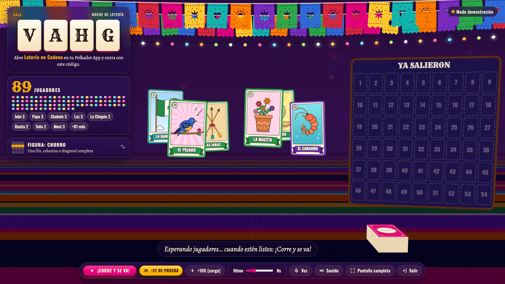
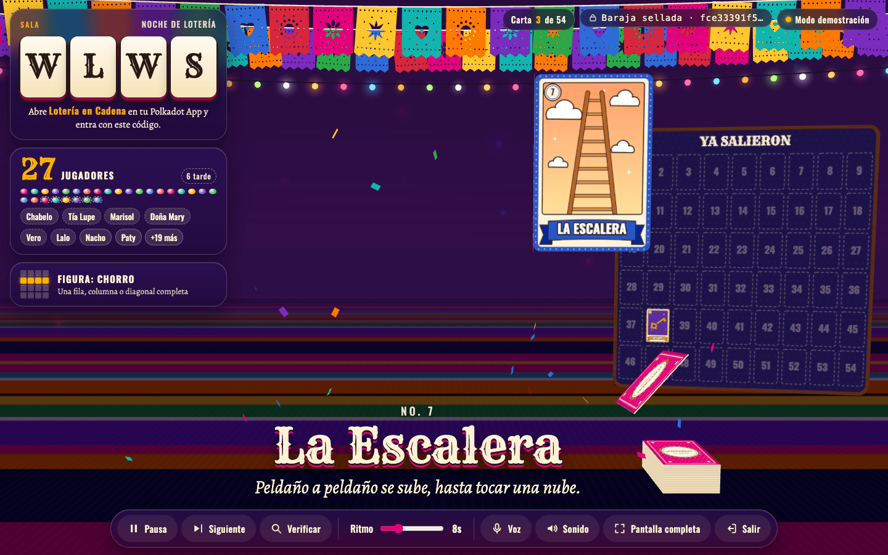
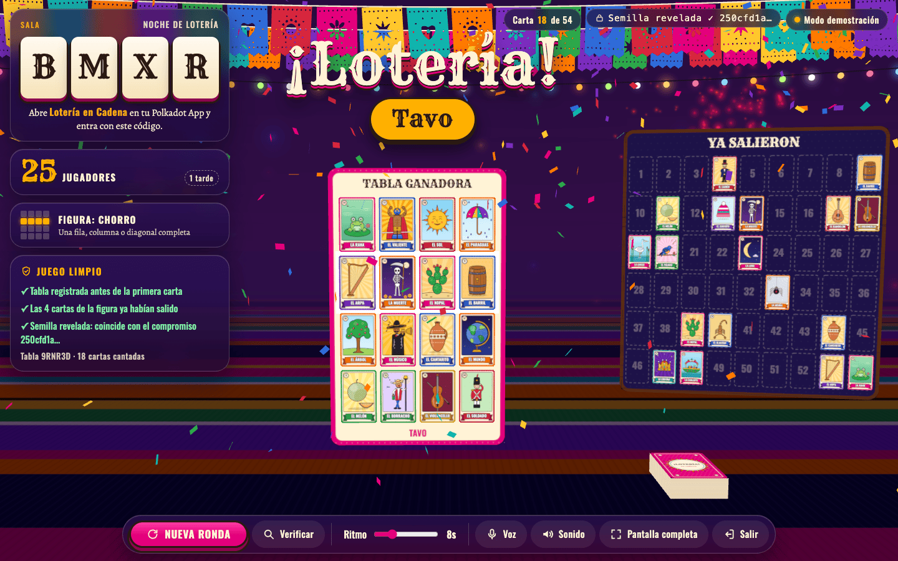
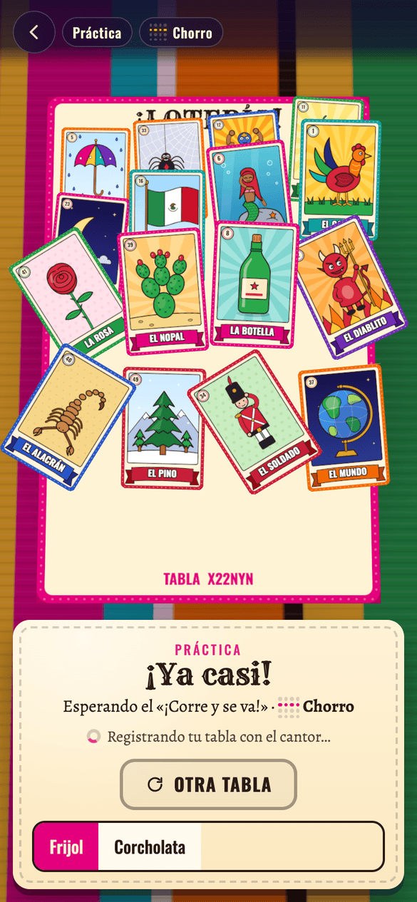
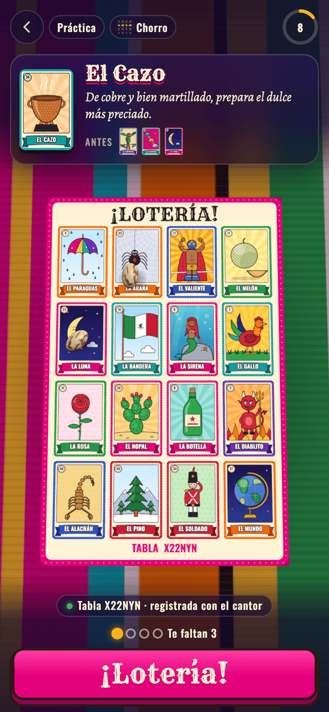
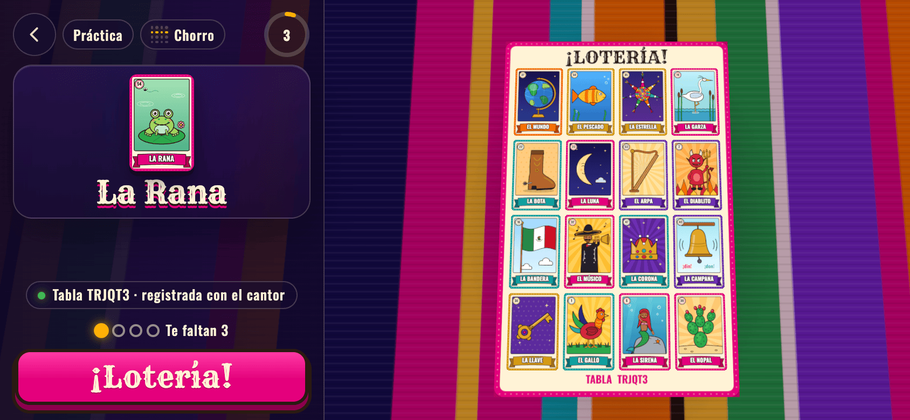
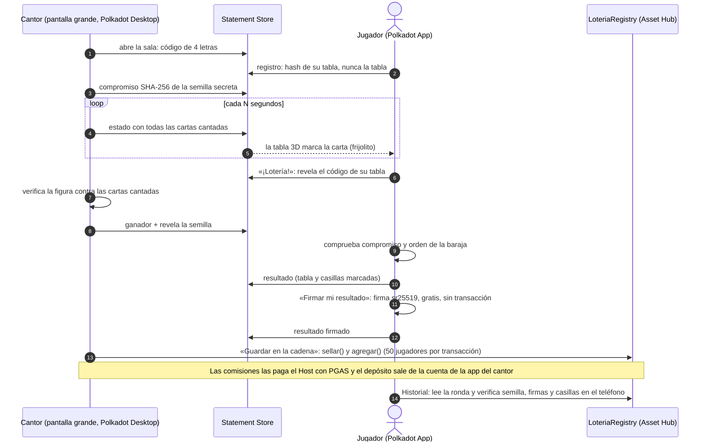
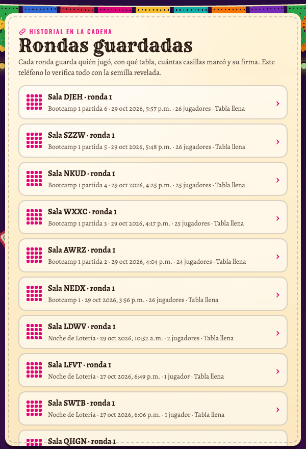
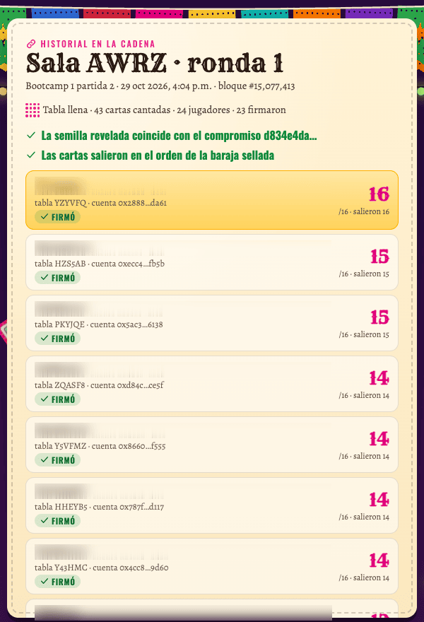
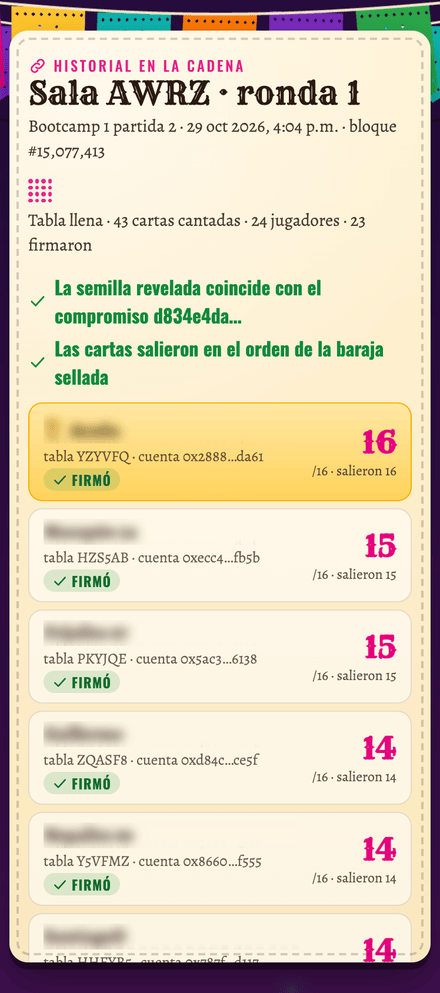

<div align="center">


**Lotería mexicana en 3D para jugar en persona con toda la sala.**<br>
Una pantalla grande hace de cantor y cada quien juega su tabla desde la Polkadot App.<br>
Los mensajes viajan por el Statement Store de Polkadot: no hay servidor.




</div>

| Cantor: partida | Cantor: ganador |
|---|---|
|  |  |

| Teléfono: espera | Teléfono: partida | Teléfono horizontal |
|---|---|---|
|  |  |  |

Más: [portada](docs/img/01-portada-escritorio.png) · [tableta](docs/img/08-tableta-juego.png) · [configuración del cantor](docs/img/09-cantor-configuracion.png).

## En el Bootcamp + Hackathon Polkadot × UANL

El **29 de octubre de 2026**, primer día del evento en la Facultad de Contaduría Pública y Administración, la sala
jugó con la Lotería: la pantalla grande cantaba y cada asistente jugaba su tabla desde su Polkadot App. Los
ganadores se llevaron **merch** del evento. Todo quedó en la cadena (leído del contrato `LoteriaRegistry` el 3 nov):

| | |
|---:|---|
| **6** | partidas «Bootcamp 1» guardadas en Asset Hub |
| **152** | resultados de jugadores (24 a 26 por partida) |
| **127** | resultados **firmados** desde el teléfono de cada jugador |
| **27** | cuentas distintas de asistentes |

Primera partida del evento: [bloque 15,077,163](https://assethub-paseo.subscan.io/block/15077163) ·
contrato [`0x1ffee4…44ce`](https://assethub-paseo.subscan.io/account/0x1ffee4d43c109a5c91c1c1296b93cf6da4c744ce) ·
cómo se ve cada ronda en la app: [Historial en la cadena](#historial-en-la-cadena).

## Índice

[En el Bootcamp UANL](#en-el-bootcamp--hackathon-polkadot--uanl) · [Qué es](#qué-es) · [Cómo se juega](#cómo-se-juega) · [Una ronda por dentro](#una-ronda-por-dentro) · [Inicio rápido](#inicio-rápido) · [Estructura](#estructura) · [Verificación](#verificación) · [Salas grandes](#salas-grandes-25-jugadores-o-más) · [Juego limpio](#juego-limpio) · [Historial en la cadena](#historial-en-la-cadena) · [Publicar](#publicar) · [Documentación](#documentación) · [Pendientes](#pendientes) · [Licencia y créditos](#licencia-y-créditos)

## Qué es

- 54 cartas con ilustraciones y versos originales, dibujadas en canvas (sin imágenes externas).
- **Pantalla del cantor** en three.js: mazo, carta que vuela y gira, tablero de «ya salieron», papel picado,
  foquitos, confeti y fuegos artificiales.
- **Tabla 3D en el teléfono**: tocas la carta cantada y cae un frijolito (o una corcholata).
- Figuras: **tabla llena** (la de por defecto: gana quien llena toda su tabla), chorro, cuatro esquinas y centrito.
- **Juego limpio verificable**: la baraja se sella con un compromiso SHA-256 y las tablas se registran con
  un hash antes de empezar.
- **Modo práctica** contra la compu y **modo demostración** con jugadores simulados (27, o 100 para probar
  una sala grande).
- Todo en un solo archivo (`dist/index.html`, ~1 MB) que funciona dentro de la Polkadot App, Polkadot
  Desktop y Polkadot Web.

## Cómo se juega

1. **Cantor:** abre la app en la pantalla grande (Polkadot Desktop, o `dot.li` en el navegador) y toca
   **Ser el cantor**. Elige figura y ritmo, y abre la sala: aparece un código de 4 letras.
2. **Jugadores:** abren la app en su Polkadot App, tocan **Jugar con mi tabla** y eligen la sala (o
   escriben el código). Cada tabla queda registrada con el cantor.
3. Cuando estén listos: **¡Corre y se va!** La voz del cantor lee el verso y el nombre de cada carta (si el
   equipo tiene voces en español).
4. Quien completa la figura (por defecto, **toda su tabla**) toca **¡Lotería!**; la pantalla verifica la tabla sola y celebra.
5. **Nueva ronda** regresa las cartas al mazo; los teléfonos se registran solos.

Atajos del cantor: `Espacio` pausa · `→` siguiente carta · `V` verificar tabla · `F` pantalla completa ·
`M` silencio · `Enter` empezar.

**Si el aviso no llega** (sin red o sin permiso para publicar), el teléfono muestra el código de su tabla
(6 caracteres): en la pantalla grande usa **Verificar tabla**, escríbelo y declara al ganador. **Quien llega
tarde** puede jugar: si gana, el cantor ve su tabla y la aprueba o la rechaza. **Si se recarga la pantalla del
cantor**, entra a **Ser el cantor → Retomar sala** (conserva baraja sellada, cartas y tablas registradas).

## Una ronda por dentro

No hay servidor: la pantalla del cantor y los teléfonos se hablan por el **Statement Store** de Polkadot (mensajes
de menos de 480 bytes que el Host de la Polkadot App reparte). Solo el final de la ronda va a un contrato.



Detalle del protocolo en [`docs/arquitectura.md`](docs/arquitectura.md) y del historial en
[`docs/historial.md`](docs/historial.md).

## Inicio rápido

Necesitas Node 20 o más reciente.

```bash
git clone https://github.com/w3nerick/Loteria-On-Chain.git
cd Loteria-On-Chain
npm ci
npm run dev        # http://127.0.0.1:5174 · modo demostración, sin Polkadot App
```

Con dos pestañas del mismo navegador (una **Ser el cantor**, otra **Jugar con mi tabla**) se prueba el juego
completo; el botón **+100 (carga)** del cantor llena la sala de jugadores simulados.

| Comando | Qué hace |
|---|---|
| `npm run dev` | servidor local en modo demostración |
| `npm run build` | genera `dist/index.html` (un solo archivo, con el SDK de Polkadot) |
| `npm run build:preview` | igual, sin SDK (solo modo demostración) |
| `npm run check` | verifica el repositorio (ver [Verificación](#verificación)) |
| `npm test` | pruebas del protocolo, el juego y las salas grandes (~40 s) |
| `npm run test:scale` | solo las pruebas de salas grandes |
| `npm run carga` | mide registro y confirmación con `N` jugadores simulados |
| `npm run icono` | dibuja `icon.png` (el ícono de la Polkadot App) con el arte de las cartas; necesita Chrome |
| `npm run manifest` | escribe en DotNS el nombre, la descripción y el ícono que muestra la Polkadot App (firma en el celular) |

## Estructura

```
.
├── index.html            # entrada; Vite la empaqueta en un solo archivo
├── vite.config.js
├── src/
│   ├── main.js           # arranque: transporte, almacenamiento, escenario 3D y app
│   ├── config.js         # ajustes del evento (dotName, ritmo, jugadores de prueba)
│   ├── style.css         # sistema visual (vidrio + boletos) y layouts
│   ├── fonts.js          # tipografías empaquetadas (Rye, Oswald, Alegreya)
│   ├── cards/            # las 54 cartas: datos, versos y arte en canvas
│   ├── game/             # motor: cantor, jugador, reglas, criptografía, bots
│   ├── net/              # protocolo, filtro de Bloom, transportes, almacenamiento
│   ├── chain/            # historial en Asset Hub: formato, firmas, contrato, sello y lectura
│   ├── three/            # escenas 3D (portada, cantor, tabla) y efectos
│   └── ui/               # pantallas, HUD, sonido y voz
├── contract/             # LoteriaRegistry (Solidity → PolkaVM), pruebas y deploy
├── test/                 # protocolo, partida de 30, salas de 100, empates, historial, verificación
├── scripts/
│   ├── check.mjs         # verificación del repositorio (sin dependencias)
│   └── carga.mjs         # prueba de carga del motor
├── docs/                 # arquitectura, diseño, publicación, guía del evento, imágenes
└── .github/              # CI y plantilla de pull request
```

## Verificación

`npm run check` no necesita dependencias y termina con error si algo se rompe en silencio:

- archivos obligatorios, `package.json` (licencia, `engines`, scripts) y que el CI llame a scripts que existen;
- enlaces e imágenes de todos los `.md` (incluidas las anclas);
- imports relativos de `src/`, `test/` y `scripts/`;
- la baraja: 54 cartas, sin ids, números ni nombres repetidos, todas con verso e ilustración;
- **privacidad:** rutas locales, correos, tokens y llaves privadas en cualquier archivo;
- nombres de archivo sin espacios ni caracteres raros, y `CONFIG.dotName` con formato válido;
- el manifest de la Polkadot App (`polkadot-app-deploy.config.mjs`): mismo dominio que `npm run deploy`, versión de
  `package.json` e `icon.png` cuadrado, de 256 px o más y de menos de 200 KB.

`test/check.test.mjs` comprueba que el verificador **sí falla** con cada caso malo. El CI
([`ci.yml`](.github/workflows/ci.yml)) corre `check`, `test` y `build` en cada push y pull request.

## Salas grandes (25 jugadores o más)

`npm run carga` simula 1 cantor + N jugadores con latencia de 30–450 ms y 8 % de mensajes perdidos, y mide tres
momentos críticos: todos entran a la vez, «Nueva ronda» (todos se vuelven a registrar) y un cantor con prisa.
Antes y después de la versión que introdujo estos cambios:

| Jugadores | Confirmar a todos: entrada / nueva ronda | Registros por jugador | Pico de registros en 200 ms | Tablas «tardías» con prisa |
|---:|---|---|---|---|
| 60 | 6.0 s / 5.4 s → **1.9 s / 3.9 s** | 1.8 → **1.3** | 60 → **14** | 10 → **0** |
| 100 | 11.0 s / 15.9 s → **1.7 s / 3.3 s** | 2.6 → **1.4** | 100 → **22** | 6 → **0** |
| 150 | 25.9 s / 35.6 s → **3.9 s / 3.9 s** | 3.6–4.7 → **1.2** | 150 → **37** | 16 → **0** |
| 250 | 49.3 s / 50.7 s → **4.0 s / 4.3 s** | 5.7–5.9 → **1.3** | 250 → **53** | 18 → **0** |

Es un solo proceso con un bus en memoria, **no el Statement Store real**: sirve para comparar versiones y
encontrar cuellos de botella, no para prometer tiempos en la red del evento.

Qué cambió y por qué:

- **Confirmación de registro con filtro de Bloom.** Antes el estado llevaba las últimas 24 confirmaciones:
  con 100 personas, 76 no se veían confirmadas y reintentaban cada 5 s. Ahora una sola copia del estado
  (< 512 bytes) confirma a toda la sala.
- **Doble chequeo con sal.** Un teléfono solo se da por registrado si se ve en dos estados con sal distinta:
  un falso positivo del filtro (~0.3 %) ya no lo deja sin registrar.
- **Registros escalonados y reintentos rápidos.** Cada teléfono espera un rato al azar (proporcional al
  tamaño de la sala) y reintenta a los 2, 5, 10 s… en vez de a los 5 s fijos.
- **Compuerta de registro.** «¡Corre y se va!» no canta la primera carta hasta que vuelve el 97 % de la ronda
  anterior (o el 85 % si ya nadie más llega; máximo 8 s más), para que nadie quede con la tabla «tardía».
- **«Retomar sala» estaba roto** (dos métodos `resume` con el mismo nombre): ahora funciona y tiene prueba.

Límites: el filtro confirma a ~160 tablas «recientes» en el lobby y a 100–150 durante la partida (solo cuentan las
oídas en los últimos 30 s, no toda la sala). Hasta 3 ganadores empatados se reconocen solos (con 100 jugadores,
4 o más empatan en menos del 3 % de las rondas). **Nada de esto sustituye una prueba con teléfonos reales en la
red del evento:** lee [`docs/evento.md`](docs/evento.md).

## Juego limpio

- Al empezar, el cantor genera una semilla secreta y publica solo `SHA-256("compromiso:" + semilla)`. El orden
  de la baraja se deriva de la semilla.
- Cada tabla sale de un código corto. Antes de la primera carta el teléfono publica solo el hash del código; al
  cantar ¡Lotería! lo revela y el cantor comprueba la figura contra las cartas cantadas.
- Al terminar la ronda el cantor revela la semilla y cada teléfono comprueba que el compromiso coincide y que
  las cartas salieron en ese orden.

## Historial en la cadena

Al terminar cada ronda, cada teléfono le manda al cantor su resultado (tabla y casillas marcadas) y el jugador
puede **firmarlo** con un toque, gratis. El cantor lo guarda todo en el contrato `LoteriaRegistry` de Asset
Hub con **Guardar en la cadena**, y la pantalla **Historial** muestra cada ronda verificada: semilla contra
compromiso, firma de cada jugador y casillas contra cartas cantadas. Detalle, formato y despliegue del
contrato en [`docs/historial.md`](docs/historial.md).

Así se ven las partidas del evento en la pantalla **Historial** (`#historial`), leídas de la cadena y verificadas
en el propio dispositivo (se taparon los apodos de los asistentes):

| Rondas guardadas | Una partida: semilla, orden y firmas verificadas | En el teléfono |
|---|---|---|
|  |  |  |

Dentro de la Polkadot App, cada paso que toca la cuenta del usuario lo aprueba el Host:

| Paso | Quién | Qué pide el Host | Costo |
|---|---|---|---|
| Entrar a la sala | jugador y cantor | permiso para publicar en el Statement Store (la primera vez) | nada |
| «Firmar mi resultado» | jugador | firmar un texto con la cuenta de la app (no es transacción) | nada |
| «Guardar en la cadena» | cantor, en Polkadot Desktop | permiso de gas y aprobar la transacción en el teléfono | comisión en PGAS, depósito en PAS |
| Ver el Historial | cualquiera | nada: solo lee el contrato | nada |

## Publicar

Destino: Products Devnet con `pad` 0.22.1 → `loteria-mexicana-on-chain.dot` (detalle, requisitos y advertencias en
[`docs/deploy.md`](docs/deploy.md)).

**Desde el 27 oct 2026 el nombre (y `app.`) es de la cuenta del organizador**, no del worker de `pad`, así que
`npm run deploy` ya no puede actualizarlo. Para una versión nueva: subir el build a un **nombre temporal** con el
*pool* de `pad` y apuntar el nombre al CID nuevo desde el teléfono (`reparador-dotns-bidc.dot` → «Apuntar versión»,
que cambia la raíz y `app.` en una firma). Receta completa en [`docs/deploy.md`](docs/deploy.md#versión-nueva-con-el-nombre-ya-traspasado).

Antes del traspaso (o con un nombre nuevo del worker):

```bash
pad login                      # interactivo: escanea el QR con tu Polkadot App
npm run deploy                 # build + pad con ficha (manifest + app.) (en Terminal.app)
```

La pantalla del cantor muestra `dotName` (`src/config.js`) para que la gente sepa dónde entrar. El contenido
en Bulletin caduca a los ~14 días: republica la semana del evento.

## Documentación

| Documento | Para qué |
|---|---|
| [`docs/arquitectura.md`](docs/arquitectura.md) | capas, protocolo, una ronda paso a paso, juego limpio, registro en salas grandes |
| [`docs/diseno.md`](docs/diseno.md) | materiales, tokens, componentes, layouts y cómo cambiar la interfaz sin romper el 3D |
| [`docs/deploy.md`](docs/deploy.md) | publicar, después de publicar, caducidad |
| [`docs/evento.md`](docs/evento.md) | guía para una sala grande: qué está medido, qué no y el piloto recomendado |
| [`docs/historial.md`](docs/historial.md) | historial en la cadena: qué se guarda, firmas, verificación y despliegue del contrato |

## Pendientes

- [x] Sala real con teléfonos de asistentes: 24 a 26 jugadores por partida en el Bootcamp UANL (29 oct 2026).
- [x] Sello del historial desde Polkadot Desktop y firma desde varios teléfonos: 6 partidas, 127 resultados firmados.
- [ ] Confirmar que el Host concede `StatementStoreAllowance` a ~100 cuentas a la vez (en el evento fueron ~26).
- [ ] Republicar antes de que caduque en Bulletin (~14 días después de cada publicación).
- [ ] Idea: QR con la dirección `.dot` en la pantalla del cantor para entrar más rápido.

## Licencia y créditos

Código bajo [licencia MIT](LICENSE). Ilustraciones (dibujadas por código), versos y diseño originales.
**La Cadena** (26) y **La Llave** (38) sustituyen a dos cartas tradicionales que hoy se consideran
estereotipos. Tipografías Rye, Oswald y Alegreya (SIL Open Font License), incluidas en el paquete.
Polkadot y su logotipo son marcas de sus titulares y no se incluyen en este repositorio.
